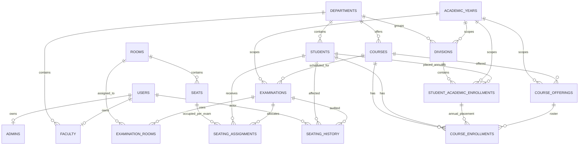

# Current S1-S6 ER Diagram

Annual placement has composite key (student_id,academic_year_id); offering has (course_id,academic_year_id). Course enrollment is unique per student/course/year. Seating is independently unique per exam/student and exam/seat. Room/seat store geometry/accessibility; assignment stores is_manual. Audit stores labels to preserve cleared assignment explanations. The single planner_lock row synchronizes writes. Invigilator duties belong to later sprints.
